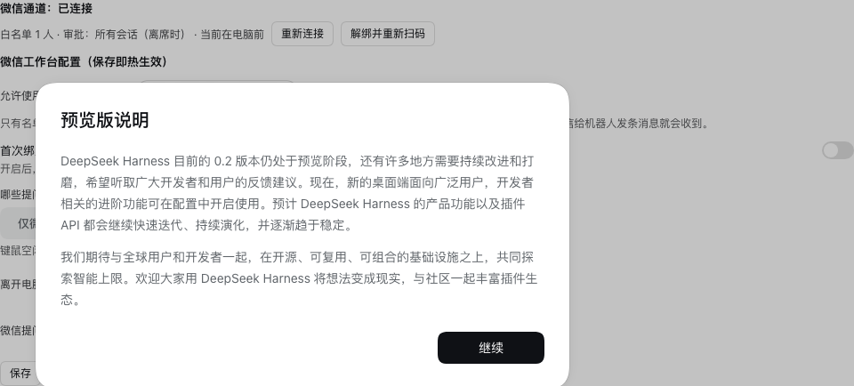

# dsh-wechat-workbench

[English](README.md) | [中文](README.zh.md)

A [DeepSeek Harness](https://github.com/deepseek-harness/deepseek-harness) (DSH) Cordis plugin that turns **WeChat into a second client of your workbench** — over WeChat's official iLink Bot long connection. Browse workspaces, switch sessions, continue conversations, watch progress, and approve agent questions from your phone. Sessions are the same durable sessions the Web GUI serves; nothing is duplicated.

```
WeChat ⇄ python/transport.py (iLink long connection, wechat-agent-sdk)
        ⇄ this plugin (Cordis, in-process)
            ├─ ctx.workspaceController   workspace navigation projection
            ├─ ctx.sessionController     list / create / prompt / page / follow
            ├─ ctx.sessionQuery          durable log reads (tail / polling fallback)
            ├─ ctx.userQuestions         approval answerer (waterfall)
            ├─ ctx.tools                 wechat_notify tool for any agent
            └─ atdesk monitor            keyboard/mouse idle → auto channel switch
```



## What it does

| WeChat command | Action |
|---|---|
| `/ws` | List workspaces |
| `/cd <n>` | Switch the active workspace (clears the session pointer) |
| `/ss` | List sessions in the active workspace (title, activity, running state) |
| `/ss <n>` | Select a session and continue it |
| `/new [title]` | Create a session in the active workspace |
| `/tail [n]` | Show the last n messages of the current session |
| `/info` | Current pointer and channel state |
| `/atdesk on\|off\|auto` | Manual override / automatic at-desk detection status |
| plain text | Ordinary follow-up prompt on the pointed session |

Design promises:

- **No parallel session universe.** WeChat holds only a pointer
  `{workspaceId, sessionId}` per conversation. A session started from WeChat
  appears in the GUI and vice versa — same durable timeline, same tools,
  same permissions, same model routing.
- **GUI-initiated turns stay silent.** Only turns started from WeChat push
  progress lines (throttled) and the final assistant reply.
- **WeChat is an approval channel.** Every human decision the agent makes
  (`ask_user_question`, plan reviews, permission prompts) flows through
  DSH's `user-questions/request` waterfall. With `approvalMode: 'all'` and the
  at-desk detector reporting *away*, questions from **any** session are pushed
  to WeChat; reply `1` / an option label / `y` / `n` (or custom text) to answer.
  Unanswered questions fall back to the GUI after a timeout.
- **`wechat_notify` tool.** Any session's agent can proactively push a message
  to the notification conversation ("ping me on WeChat when the build fails").
- **`wechat_send_file` tool.** Any session's agent can hand a local file to
  the user on WeChat — png/jpg/gif/webp render as images, mp4 as video,
  everything else as a file message.
- **Media inbound.** WeChat images are downloaded and inlined into the session
  prompt (the agent sees them with vision); files land on disk and the prompt
  references their path for the agent's fs tools.
- **Automatic at-desk detection.** Keyboard/mouse idle beyond
  `idleAwayMinutes` flips approvals to WeChat; one touch flips back. Unknown
  platforms count as at-desk (fail toward the GUI).

## Requirements

- Node.js ≥ 20, a DSH checkout or install with the `web` composition
- Python ≥ 3.11 — on first start the plugin automatically creates a local
  `.venv` and installs [`wechat-agent-sdk`](https://pypi.org/project/wechat-agent-sdk/)
  (the community iLink transport, MIT — this plugin contains no iLink protocol
  code, and the SDK exists only on PyPI, so one online setup step is
  unavoidable). Set `pipIndexUrl` to a mirror (for example Tsinghua's) if the
  official index is slow where you are; afterwards the plugin runs fully
  offline. Or point `pythonBin` at an interpreter that already has the
  dependencies.
- A WeChat account enrolled in the agent/iLink gray release (real-name
  verification required), on a machine that can reach `ilinkai.weixin.qq.com`

## Install

Recent DSH builds ship a plugin manager in the Web workbench (the 「插件」
panel): install by absolute local path (development), git URL, or npm name,
and enable or disable plugins there. This plugin ships a small browser
companion (`client/client.js`, loaded through the package's `dsh.client`
declaration), so its bundle page in that panel gains a 「配置」control with
a live-editable form, and the detail page shows the WeChat login QR and
connection status. The same fields are also editable over WeChat with
`/config`; both write the same profile patch.

CLI equivalents (no build step — the plugin is plain ESM JavaScript):

```sh
dsh plugin --profile web add github:maitutudad/dsh-wechat-workbench   # from git
dsh plugin --profile web add dsh-wechat-workbench                # from npm once published
```

`@deepseek-ai/*` packages are peer dependencies; when running DSH from a
source checkout they resolve through the checkout's own tree. Set up Python:

```sh
cd "$(dsh plugin --profile web dir dsh-wechat-workbench 2>/dev/null || echo .)"
./scripts/setup-python.sh          # creates .venv, installs wechat-agent-sdk + qrcode
```

To configure by hand instead of the UI, edit
`$DSH_HOME/profiles/web/cordis.patch.yml` — patch semantics: a non-insert
entry **targets an existing row by id and replaces the named properties
wholesale**:

```yaml
- id: wechat-workbench
  config:
    pythonBin: /abs/path/to/dsh-wechat-workbench/.venv/bin/python
    allowWxids: ['o9cq8xxxx@im.wechat']   # fail-closed when empty
    bootstrap: true                        # first run: replies with your id
    approvalMode: 'all'                    # WeChat answers every session's questions when away
```

### First run (bind WeChat, authorize yourself)

1. Turn on the first-run helper (`bootstrap: true`) — in the workbench 插件 form or by hand:
   ```yaml
   - id: wechat-workbench
     config:
       bootstrap: true
   ```
2. Start (or restart) the profile: `dsh --profile web`. The plugin's detail
   page in the 「插件」 panel shows the login QR (the terminal prints it too);
   scan it with WeChat (or open the link in WeChat). The iLink token
   persists under `~/.wechat-agent-sdk/`; later restarts reconnect without
   a scan.
3. Send any message to the bot from WeChat. Bootstrap mode replies with your
   conversation id (the `wxid_...@im.wechat` string).
4. Put that id into `allowWxids` and turn `bootstrap` off — in the 「插件」
   form, over WeChat with `/config allowWxids <id>` +
   `/config bootstrap false`, or by hand. All three write the same patch and
   apply live. You are now the only authorized user.

Config edits hot-apply when the profile has `patchReload: live`.

## Configuration

| Key | Default | Live | Meaning |
|---|---|---|---|
| `allowWxids` | `[]` | ✎ | Which WeChat accounts may use the bot (space-separated ids); **empty denies everyone**; get your id with the first-run helper |
| `bootstrap` | `false` | ✎ | First-run helper: the bot replies with your WeChat id instead of executing anything |
| `approvalMode` | `wechat-driven` | ✎ | Which questions reach WeChat: `wechat-driven` only chats started from WeChat; `all` every chat once you are away |
| `idleAwayMinutes` | `5` | ✎ | Minutes of keyboard/mouse idle that count as away |
| `pythonBin` | `python3` | ↻ | Interpreter for the transport child; the default auto-uses (or first-start creates) the plugin's `.venv` |
| `autoSetupPython` | `true` | ↻ | First start creates the `.venv` and installs from PyPI when `pythonBin` is default |
| `pipIndexUrl` | `''` | ↻ | pip mirror for the automatic install (empty = official PyPI) |
| `accountId` | `dsh` | ↻ | iLink account key for token persistence (restart to apply) |
| `answerTimeoutMs` | `600000` | ✎ | Milliseconds a WeChat question waits before falling back to the page |

✎ fields are volatile: editable in the 「插件」 form, over WeChat with
`/config`, or by hand — all applied live without a restart. ↻ fields apply
on the next start.

## Security model

- **Fail-closed authorization**: empty allowlist = the plugin logs and ignores
  everything; unauthorized senders get a single rejection line. Group chats
  are out of scope — the plugin serves one bound 1:1 conversation and drops
  anything arriving from a group.
- Approval questions are claimed from WeChat only for sessions WeChat drives
  (or, in `'all'` mode, when the at-desk detector reports away); everything
  else falls through to the GUI answerer via `next()`.
- The iLink token persists under `~/.wechat-agent-sdk/`; `logout()` in
  `python/transport.py` clears it.
- No cloud component: messages ride WeChat's iLink channel straight to your
  machine; DSH executes locally.

## Development

```sh
npm install --no-save --prefix <dsh-checkout>   # not required; peers resolve at runtime
npm test                                        # 31 tests, no external services
```

The suite includes contract tests written against DSH's real service shapes
(`SessionFollowRequest.address`, workspace follow baseline frames,
`sessionQuery.readSession`, the `user-questions/request` waterfall) and a
protocol test that drives the real `python/transport.py` against a fake
`wechat_agent_sdk` module.

Integration notes for contributors (service request shapes, event vocabulary,
loader conventions) live in [docs/INTEGRATION-NOTES.zh.md](docs/INTEGRATION-NOTES.zh.md).

## Known limitations

- The iLink Bot channel is gray-release; protocol changes land in
  `wechat-agent-sdk` — upgrade the dependency, this plugin owns no protocol code.
- Media download can fail while `wechat-agent-sdk` 0.2.1's CDN request shape
  returns `400` even for fresh images; the session then records an explicit
  `[媒体接收失败]` note instead of the attachment. Upgrading the SDK when a
  fix ships should restore media inbound.
- Inbound images are inlined up to the DSH 20 MiB image intake limit; larger
  images and all other files are saved to `~/.dsh-wechat-workbench/media/` and
  referenced by path for the agent's fs tools.
- Voice messages arrive as their transcription text; the audio itself is saved
  as a file attachment.
- The follower degrades to 3-second `sessionQuery` polling if the live follow
  stream throws, so delivery survives host-internal stream errors.

## License

[MIT](LICENSE). Depends on [wechat-agent-sdk](https://pypi.org/project/wechat-agent-sdk/)
(MIT, PyPI-distributed) for the iLink transport.
